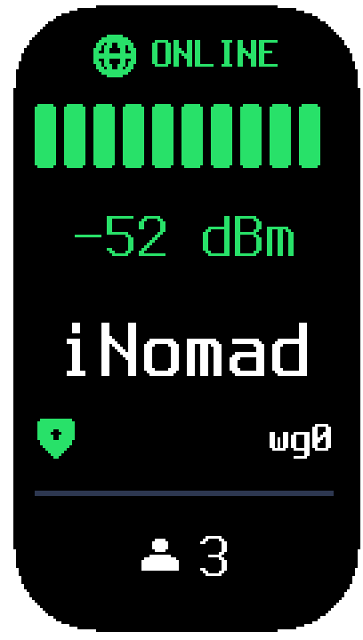
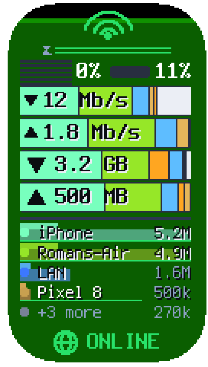
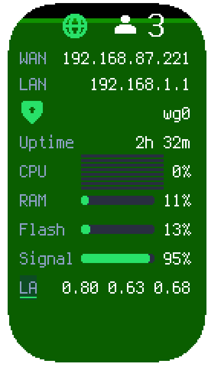

# utr-lcd - LCD status display for the UniFi Travel Router (OpenWrt)

Drives the built-in 1.14" 136x240 LCD of the **UniFi Travel Router Long-Range** (UTR-LR, IPQ4018)
running OpenWrt. It shows the Wi-Fi/Ethernet/USB uplink, signal, WAN IP, VPN state, connected
clients and uptime, and survives reboots as a normal procd service.

Two display modes (`mode` in `/etc/config/utr-lcd`):

| Mode | What you get | Needs |
| --- | --- | --- |
| `native` | Built-in high-contrast status screen, tuned for off-axis viewing | nothing, ships in the package |
| `stock` | The original Ubiquiti UI (pixel-identical, themes, signal bars, ...) fed with OpenWrt data | optional bundle you build from **your own** firmware |

`auto` (default) uses `stock` when the bundle is installed, otherwise `native`. `stock` without the bundle also falls back to `native` (logged).

## The default screens

The native renderer rotates through three screens out of the box — *Status*, *Traffic* and
*Details*. Rendered offline with example data (the panel as you would see it, bezel and all):

| Status | Traffic | Details |
| --- | --- | --- |
|  |  |  |

Every screen is a stack of widgets you can rearrange, resize or replace, either in
`/etc/config/utr-lcd` or visually in the LuCI app (Services > LCD Display, Screens tab) with a
live preview before you save.

## Requirements

- OpenWrt on the UTR / UTR-LR with the LCD panel driver (`kmod-drm-panel-mipi-dbi`, device tree node
  `ubnt,utr-lcd`) - `/dev/dri/card0` must exist.
- `iwinfo` command (default in OpenWrt images) for Wi-Fi uplink details.

## Install

Build for your release with the OpenWrt SDK (see below), copy the package to the router and:

```sh
# snapshot / apk-based releases
apk add --allow-untrusted ./utr-lcd-*.apk
# opkg-based releases
opkg install ./utr-lcd_*.ipk
```

The service starts immediately and at boot. `service utr-lcd restart` after editing the config.

### Optional: LuCI page

`luci-app-utr-lcd` adds **Services > LCD Display**: a settings form for every option below and a live
status panel (running mode, panel driver, stock bundle, uplink, WAN IP, VPN, clients). Install it the
same way (`apk add --allow-untrusted ./luci-app-utr-lcd-*.apk` or `opkg install ./luci-app-utr-lcd_*.ipk`).
Save & Apply restarts the display service.

The same page has a **Screens** tab, an editor for the native screens: add, reorder and remove
screens, set dwell time and signal backfill per screen, pick widgets and sizes (a
meter shows the used and free pixels of the screen and an "add" choice that no longer fits is greyed
out), set the rotation order, and see every screen drawn by the router's own renderer while you edit,
before saving. The preview can use live data or example data and can play what-if cases (weak Wi-Fi,
wired uplink, no uplink, no internet, VPN up/down/none). The editor is greyed out while the stock look
is running.

### Optional: stock Ubiquiti look

Ubiquiti's UI binaries are proprietary and cannot be redistributed, so build the bundle from a
firmware image you downloaded yourself (any 6.6.x UTR firmware from ui.com):

```sh
tools/make-stock-bundle.sh UTR-6.6.118.bin utr-ui-stock.tar.gz      # needs docker
scp utr-ui-stock.tar.gz root@192.168.1.1:/tmp/
ssh root@192.168.1.1 utr-lcd-stock-install /tmp/utr-ui-stock.tar.gz
utr-lcd-stock-install --remove                                      # go back to native
```

The stock `ulcmd` runs from its own musl loader and libraries (it is a soft-float ARM binary),
under a small `LD_PRELOAD` shim (`utr-lcd-fbshim.so`) that fakes `/dev/fb0`, feeds it a stock-style
Wi-Fi signal, and **refuses `system()`/`popen()`** so the UI can never reboot or power off the router.
It talks to a private ubus (`/var/run/ubus.sock`); OpenWrt's own ubus is untouched. Nothing is run
from flash except the bundle itself (~7 MB in `/usr/share/utr-lcd/stock`).

## Configuration (`/etc/config/utr-lcd`)

| Option | Default | Meaning |
| --- | --- | --- |
| `enabled` | `1` | start the service |
| `mode` | `auto` | `auto`, `native`, `stock` |
| `interval` | `3` | seconds between status refreshes |
| `rotate` | `180` | panel rotation (`180` on the UTR-LR, which is mounted upside-down; or `0`) |
| `brightness` | empty | backlight percent 1-100; empty leaves it alone (stock mode otherwise starts at 80) |
| `theme` | `blue` | stock mode: `blue aqua green pink yellow orange purple` |
| `offset_x`, `offset_y` | `2`, `0` | stock mode: placement of the 135x240 image in the 136x240 panel (calibrated on the glass) |
| `dim_after` | `0` | both modes: dim the backlight after this many seconds without motion; `0` never dims |
| `dim_level` | `15` | backlight percent while dimmed |
| `motion_threshold` | `50` | motion that restores full brightness, in milli-g (1000 = 1 g); lower is more sensitive, below about 15 the sensor noise triggers it |
| `sensor_rate` | `25` | accelerometer sampling rate in Hz while dimming is active (the driver default of 1 Hz makes every read block for seconds); `0` leaves it alone |
| `screen_mode` | `rotate` | native mode: `rotate` through the screens, or `pin` one (`screen_pin`, 1 = first screen) |
| `playlist` | empty | native mode: order of rotation by screen number, e.g. `1 2 1 3` shows screen 1 twice per round; empty = every enabled screen in order |
| `name_len` | `8` | native mode: client names on traffic screens are cut to this many characters (3-16) |
| `fill_dim`, `fill_edge` | `30`, `1` | native mode: Wi-Fi signal backfill brightness in percent of the full colour, and a bright line at its edge |
| `screen_timeout` | `0` | both modes: turn the backlight off after this many seconds without motion; `0` never turns it off. Moving the router restores full brightness |

### Screens (native mode)

The built-in renderer shows one or more screens, each a stack of widgets over an optional signal backfill.
`config screen` sections define them in order (screen 1 is the first section); the defaults are *Status*
(SSID, signal, client count, 8 s), *Traffic* (speeds, per-client share bars, legend, 8 s) and *Details* (WAN IP, LAN IP, VPN, uptime, 5 s).

| Option | Default | Meaning |
| --- | --- | --- |
| `name` | | label for your own use |
| `dwell` | `8` | seconds on screen, 0.5 or more |
| `spacing` | `auto` | gap between widgets in pixels (`2`-`18` in the editor, up to `30` via uci); `auto` spreads the spare room (at most 14 px). Use a small fixed value on dense screens such as *Details* |
| `enabled` | `1` | `0` keeps the screen configured but out of the rotation |
| `indicator` | | legacy, ignored: the online status is a widget (`status`), not a panel option |
| `backfill` | `1` | colour the screen from the bottom by the Wi-Fi signal (red poor, green full); only for a Wi-Fi uplink |
| `list widget` | | widgets top to bottom as `type:size`: `ssid dbm bars fan segbar status clients` (sizes 16, 24, 32, fan also 48; a trailing `w` on the SSID, `ssid:24w`, wraps a long name to a second line at the chosen size instead of shrinking and cutting it, and a trailing `s`, `ssid:24ws`, additionally steps the font size down (24, 16, 12) until the whole name fits on those two lines; `bars` is the Wi-Fi signal as five ascending bars, `segbar` as the stock-style segmented bar (10 segments) and `fan` as a dot-and-arcs Wi-Fi icon, Wi-Fi only; `status` is the online-status globe: green ONLINE, amber NO INTERNET, red slashed NO UPLINK - with a full line it also shows the words, in a shared line the icon alone changes; `sigbar` is the Wi-Fi signal as a resource-style line bar with a percent value (size 24: a tall bar with the dBm value on top), Wi-Fi only). Widgets joined by `+` share one line (up to three, e.g. `dot:16+clients:24`), each centred in its third of the line - handy for small widgets, `wanip lanip vpn uptime` (12, 16), `rule`; traffic widgets: `speed` (16, 24: down and up, two lines), `speed1` (16: down and up on one line), `speedbar` / `usagebar` (bar height 12, 16, 20, 24: current speed / total traffic split by client, plus a white segment for the traffic no client accounts for - the router itself, missed stations - when that is more than a sliver; the bar is then scaled by the real interface total), `speeddn` / `speedup` (download/upload split by client), `speeddn` / `speedup` carry a small direction triangle at the left end, and a trailing `v` (e.g. `speeddn:12v`) also writes that direction's total speed on the bar, which makes a separate `speed1` line unnecessary; `usagedn` / `usageup` (12, 16, 20, 24: downloaded/uploaded bytes split by client, with the total written inside the bar, left-aligned; 20 and 24 use the large bold text, 24 in a thicker bar), `usage` (12, 16), `legend` / `legendtotal` (the number is the count of client rows: colour chip, name, current speed / total; the last row becomes `+k more`; flags after the size: `b1`-`b5` background bar - speed, total, signal as a 1 px line coloured by strength (green/amber/red), or signal combined with speed/total - and `f` / `F` to squeeze more clients into the same height, gently or compactly; `p` scales the speed bar by the fastest rate seen so far (forgotten slowly, halved every 10 minutes) instead of the current leader, who would always be full width; `x` splits the bar into a thin upload strip on top and download below, each scaled by its own direction's fastest client, while the number stays the sum), `donut` (diameter in pixels, current speed split by client, total speed in the middle), `multiwan` (12, 16: per uplink name and share of the current traffic with a bar; only shown when there are two or more uplinks), `uplinks` (16, 24: one Wi-Fi fan / Ethernet port icon per uplink, coloured by state - green online, amber when mwan3 says online but there is no default route, red offline, dim standby - with two 1 px lines under it showing the observed download/upload split; driven by `mwan3 status` when mwan3 is installed, flags `l` icon beside the name, `g` short WiFi/Eth names, `n` no names and `i` no icons; always shown, even with no uplink); resources: `cpu`, `ram`, `flash`, `load`, `temp` (12, 16) and `cpuram` (12, 16: CPU and RAM side by side on one line, each with its own small bar - handy on screens that are not a stack of resource rows); `cpu:16c` splits the bar into one segment per core and `cpu:16r` into one full-width strip per core stacked in the same row, `load` is the load average against the core count with the 1/5/15 values, `temp` is the Wi-Fi chip and is hidden without a sensor). A widget with nothing to show (no VPN configured, no signal) takes no room; spare room is spread between the widgets. Text steps down to a smaller size before it is cut, addresses are shortened in the middle |

Traffic is sampled by `traffic.sh` every 2 s, only while a screen that is shown has traffic widgets, and kept in RAM (`/var/run/utr-lcd/traffic`; nothing is written to flash). Uplinks are all default routes (in any routing table, so mwan3 setups work too; VPN devices excluded), lowest metric first; with two or more, `multiwan` shows each one's share and a higher-metric uplink without traffic is labelled `backup`. With several Wi-Fi uplinks the signal backfill is split into one vertical strip per uplink (this is only visible as such, no extra text). Wi-Fi clients come from `iw station dump` (names from the DHCP leases), all wired ports together count as one client `LAN`, totals are since the sampler started. Each client keeps its colour (hash of the MAC); the biggest six get a bar segment, the rest share a grey one.

While the backlight is off the rotation pauses. Edit with `uci` and `uci commit utr-lcd; reload_config`, or use the LuCI editor (Services > LCD Display, Screens tab).

One screen can be rendered once for inspection: `utr-lcd-status -P -N 2 -C screens.conf -c /usr/libexec/utr-lcd/collect.sh` prints it as run-length text (`tools/rle2png.py` turns that into a PNG); this is what the LuCI preview uses.

## How it works

- The panel is driven through DRM (`panel-mipi-dbi`, write-only): the renderer makes a dumb buffer,
  sets the CRTC once and updates with `DIRTYFB`. Raw ioctls, no libdrm; orientation is done in software.
- `collect.sh` gathers the state (default-route uplink, Wi-Fi via `iwinfo`, VPN by interface name,
  clients from ARP, uptime). `utr-lcd-status` renders it (native) or `feed.sh` pushes it to the stock
  UI's `ui state` / `ui info` ubus methods (stock; replaces Ubiquiti's `mcad`).
- `utr-lcd-fb2drm` copies the stock UI's fake framebuffer to the panel.

Findings about the stock firmware are in `docs/stock-ui-notes.md`.

## Building

```sh
tools/build-package.sh                                # snapshot SDK  -> build/sdk-out/*/ (utr-lcd + luci-app-utr-lcd, .apk)
tools/build-package.sh ipq40xx-generic-24.10.4        # opkg release -> .ipk
make -C package/utr-lcd/src CC=...                    # just the C programs
```

## Licence

MIT (see `package/utr-lcd/LICENSE`). The 8x16 font is derived from Terminus (SIL OFL 1.1).
UniFi and Ubiquiti are trademarks of Ubiquiti Inc.; this project is not affiliated with Ubiquiti.
